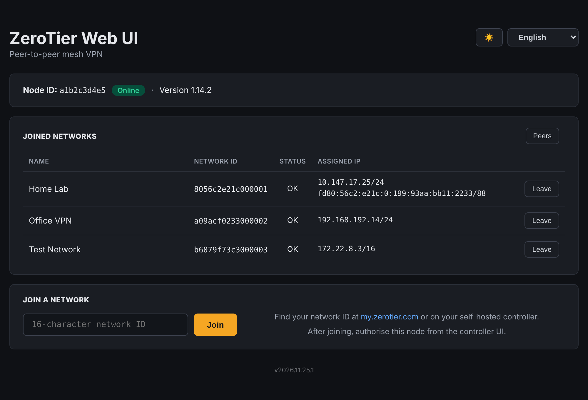
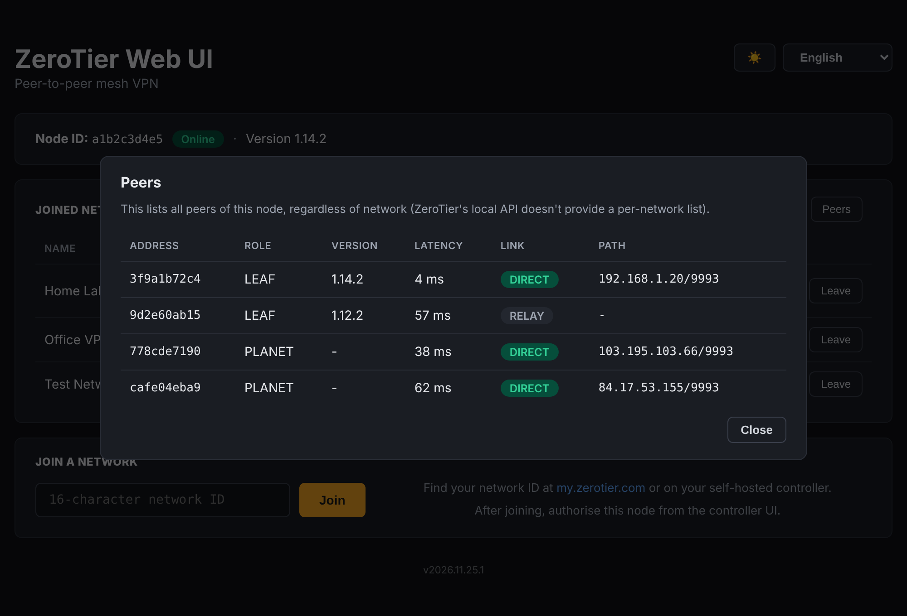

# ZeroTier Web UI

🇬🇧 English · [🇷🇴 Română](README.ro.md)

A small, self-contained web interface for a **natively installed ZeroTier** daemon (Ubuntu / Linux).
It shows the Node ID and status, lists joined networks, lets you join / leave networks and
inspect peers from a browser. It is built locally from source (no third-party image), with
Basic Auth, CSRF protection, 12 languages and a dark theme by default.

## Screenshots





## Features

- Single Docker container (Flask + waitress) on port **8080**
- Talks to the local ZeroTier API (`127.0.0.1:9993`) using `authtoken.secret`
- Basic Auth (`.htpasswd`) on every route, CSRF token on join/leave
- Joined networks with Online/Offline badge, IPv4/IPv6 addresses, join / leave
- **Peers** modal (equivalent of `zerotier-cli peers`: role, latency, direct/relay, path)
- 12 languages loaded from `zerotier-web-ui/language/*.json` (Romanian default); add a language without touching code
- Dark (default) / light theme, responsive layout, version shown discreetly in the footer

## Requirements

- Docker + Docker Compose
- ZeroTier installed natively and working (`zerotier-cli info`)
- `apache2-utils` to create the `.htpasswd` file: `sudo apt install -y apache2-utils`

## Installation

```bash
git clone https://github.com/ms74ro/ZeroTier-Web-UI.git zerotier-web
cd zerotier-web

# create the credentials file (first user: -c; omit -c for additional users)
htpasswd -c .htpasswd admin

docker compose config            # validate the YAML
docker compose up -d --build
```

Open `http://<server-ip>:8080` and sign in. Check that unauthenticated access is refused:

```bash
curl -I http://127.0.0.1:8080/   # 401 Unauthorized
```

### Project layout

```
zerotier-web/
├── docker-compose.yml
├── .htpasswd                 # created by you, never committed
└── zerotier-web-ui/
    ├── Dockerfile
    ├── requirements.txt
    ├── app.py
    ├── favicon.svg           # replace with your own SVG if you like
    └── language/             # one JSON file per language
```

### docker-compose.yml notes

- `network_mode: host` is required so the app can reach the daemon at `127.0.0.1:9993`.
- `/var/lib/zerotier-one` is mounted read-only (the app reads `authtoken.secret`).
- `.htpasswd` is mounted read-only.
- `language/` is mounted, so language files can be edited **without a rebuild**.
- `TZ` only affects the timestamps in `docker compose logs`; change it to your timezone.

## Nginx Proxy Manager (optional)

Add a Proxy Host: scheme `http`, forward host = your server LAN IP (or `172.17.0.1` if NPM runs in a bridge network
and cannot reach the LAN IP), port `8080`. Do **not** add an NPM Access List — the app already asks for credentials.

## Languages

Shipped: Română (default), Български, Deutsch, Ελληνικά, English, Español, Français, Italiano, Nederlands,
Polski, Svenska, Україна. The language menu is built automatically from the folder.

Add a language:

1. `cp zerotier-web-ui/language/en.json zerotier-web-ui/language/ja.json`
2. Change `_name` and translate the values (keys stay the same). `{id}` in `confirmLeave` is replaced by the network ID.
3. `python3 -m json.tool zerotier-web-ui/language/ja.json > /dev/null && echo OK`
4. Reload the page.

Missing keys fall back to Romanian (`DEFAULT_LANG` in `app.py`). "Node ID" and "Peers" are intentionally left untranslated.

## Peers

The **Peers** button (next to "Joined networks") opens a modal with all peers of this node. The list is node-wide,
not per network: ZeroTier's local API does not say which peer belongs to which network. Close with the button, **Esc** or a click outside.

## Updating

```bash
git pull
docker compose up -d --build
```

Changes in `language/*.json` only need a page reload.

## Versioning

Date-based: `YYYY.MM.DD.counter` (e.g. `2026.11.25.1` is the first release of 25 Nov 2026).
The value is the `VERSION` constant in `zerotier-web-ui/app.py`, shown in the page footer, and equals the
git tag (`v2026.11.25.1`). See [CHANGELOG.md](CHANGELOG.md).

## Security summary

- No admin rights on ZeroTier: the app only reads `authtoken.secret` (read-only mount) and calls the local API.
- Basic Auth protects all routes, including `/join`, `/leave` and `/peers`.
- CSRF token on join/leave; a POST without a valid token gets `403` (a page refresh fixes it after a container restart).
- Reachable on `:8080` from outside your LAN? Credentials are still required, but consider a firewall rule (`ufw`) to limit it to your LAN.

## Troubleshooting

- **`path ".../zerotier-web-ui" not found`** — the `zerotier-web-ui/` subfolder is missing; use the layout above.
- **`did not find expected key` (YAML)** — stray tabs/hidden characters; recreate the file and run `docker compose config`.
- **Empty language menu** — `zerotier-web-ui/language/` must exist on the host (Docker would mount an empty folder otherwise). Invalid JSON files are skipped silently; check with `python3 -m json.tool`.
- **Build fails on `favicon.svg`** — the Dockerfile copies it explicitly; keep an SVG with that name.
- **`403` on first join/leave after a restart** — refresh the page to get a new CSRF token.
